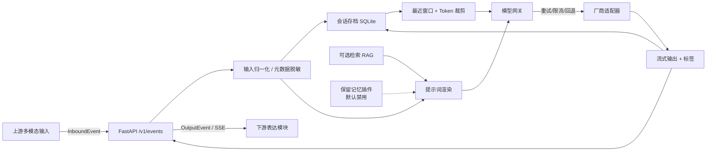

# OmniNexus

**本地优先的 LLM 编排核心（Local-first LLM Orchestration Core）**

OmniNexus 接收上游多模态输入事件，完成模型路由、提示词渲染、上下文组装、可选联网检索，输出带
`emotion / type / intent` 标签的标准化事件。它可独立运行，不依赖上游或下游模块；所有对话、提示词、
引用和设置默认保存在本机 SQLite。

[](https://github.com/zhipianxiaokonglong/OmniNexus/actions/workflows/ci.yml)
[](LICENSE)

---

## 当前范围（v0.3.0）

- **审计修复**：Emotion contract v2（12 类）、session 信号、引用正文策略、默认模型首跑回退与
  metadata/session_id 兼容告警。
- **自定义模型提供方**：设置页可添加/编辑/删除/启停 OpenAI-compatible 提供方，填写 Base URL、
  API Key、模型与能力；支持 `/models` 拉取、三级连接测试、多模态探测、默认提供方/模型。
- 内置厂商保留为**只读**；自定义提供方仅支持 OpenAI 兼容协议。
- API Key 使用本机 AES-GCM 加密存储；前端只显示掩码，不返回完整 Key，不导出 Key。
- 历史会话不静默迁移；提供方不可用时保留历史、提示切换，并提供手动迁移向导。

外部记忆管线协作已取消，不属于本期交付：

- **正式记忆机制**：本地对话存档 + Token 预算内的最近对话窗口，按正式功能验收。
- **外部记忆管线**：仅作为 **Reserved for future use** 的插件接口保留；默认禁用，健康探测固定
  返回 `unavailable`，对主流程零影响。契约冻结、适配器与 mock 验证保留，后续不得删除。
- **提示词**：默认系统提示词为空。仓库**不包含任何正式人设或测试人格**；产品完成后通过提示词
  API / 页面统一填写。

## 功能

| 能力 | 实现 |
| --- | --- |
| 多厂商 / 多模型 | 16 家云端厂商 + Ollama、LM Studio、vLLM、llama.cpp（内置只读） |
| 自定义提供方 | Chatbox 式添加：名称、Base URL、Key、模型、能力、请求头、协议、超时 |
| 提供方管理 | 列表/编辑/删除/启停、默认提供方与模型、导入导出（不含 Key） |
| 连接测试 | 三级测试（地址/模型列表/模型聊天）+ 多模态探测 + 未验证状态 |
| 运行时切换 | 提供方 + 模型双选择；会话级切换，存档为厂商无关消息，切换后延续上下文 |
| 故障降级 | 重试 → 同模型回退链 → 可配置模型重路由；SSE 中断保留部分答案 |
| 模型网关 | 流式 SSE、连接/首 Token/总超时、指数退避、进程内令牌桶限流 |
| 提示词 | 配置档案、不可变版本、激活/回滚/重置、Jinja2 沙箱变量注入；模型无关 |
| 提示词 UI 接口 | 读取、创建、保存新版本、激活版本、重置、删除、预览 |
| 联网搜索 | Tavily / Brave / SearXNG / DuckDuckGo / 自定义源；RAG + 引用溯源 |
| 多模态协商 | 模型能力表；缺视觉能力时自动路由视觉模型，否则带说明降级为文字 |
| 对话存档 | SQLite 持久化、历史、标题、导出 JSON/Markdown、删除、上下文裁剪 |
| 情感 / 类型 / 意图标签 | 本地确定性分类器；Emotion contract v2（12 类），逐帧随输出事件下发 |
| 隐私 | 数据本地；自定义 Key 加密落库；日志脱敏；搜索只发送当前查询 |
| 离线演示 | 可选 `echo` 诊断模型，零密钥跑通完整链路（默认关闭） |

## 快速开始

要求：**Python 3.11+**。以下命令在仓库根目录执行。

### Windows PowerShell

```powershell
git clone https://github.com/zhipianxiaokonglong/OmniNexus.git
cd OmniNexus
py -3.13 -m venv .venv
.\.venv\Scripts\Activate.ps1
python -m pip install -e ".[dev]"
Copy-Item .env.example .env
# 编辑 .env，至少填入一个厂商密钥，例如 OPENAI_API_KEY=...
python -m omninexus
```

### Linux / macOS

```bash
git clone https://github.com/zhipianxiaokonglong/OmniNexus.git
cd OmniNexus
python3 -m venv .venv
. .venv/bin/activate
pip install -e ".[dev]"
cp .env.example .env
# 编辑 .env
python -m omninexus
```

打开 <http://127.0.0.1:8000>，API 文档在 <http://127.0.0.1:8000/docs>。

### 添加自定义提供方

进入 **设置 · 模型提供方**（<http://127.0.0.1:8000/settings>）：

1. 点击“添加自定义提供方”；
2. 填写名称与 Base URL（严格拼接，不自动补 `/v1`，placeholder 为
   `https://api.example.com/v1`）；
3. 填写 API Key（本地无鉴权服务可留空）；
4. 手动添加模型或“从 /models 拉取”；配置能力预设（文本/视觉/上下文窗口）；
5. 点击“测试连接”，通过后保存；
6. 在默认设置或聊天页选择该提供方/模型。

> Key 只在本机加密保存；页面只显示 `sk-****abcd`。测试请求不落库、不写日志。

### 零密钥离线验证

```powershell
$env:OMNI_ENABLE_ECHO = "1"
python -m omninexus
```

页面选择 **Offline diagnostic echo**，或调用 API 时指定 `metadata.model = "echo:echo"`。该模型只回显
输入并说明未调用外部模型，用于验证“输入 → 处理 → 带标签输出”，**不是产品人设**。

```powershell
$body = @{
  event_id = [guid]::NewGuid().ToString()
  parts = @(@{ modality = "text"; content = "你好，介绍一下你自己" })
  metadata = @{ model = "echo:echo" }
} | ConvertTo-Json -Depth 6

Invoke-RestMethod -Method Post -Uri http://127.0.0.1:8000/v1/events `
  -ContentType "application/json" -Body $body | ConvertTo-Json -Depth 6
```

输出（字段严格符合下游契约）：

```json
{
  "event_id": "…",
  "session_id": "…",
  "content": "…",
  "stream": false,
  "tags": { "emotion": "neutral", "type": "text", "intent": "reply" }
}
```

流式调用加 `Accept: text/event-stream`（或 `?stream=1`）。SSE 帧语义见
[API 契约](docs/api.md#sse-语义)。

## 架构



详细设计见 [架构说明](docs/architecture.md)。

## 支持的厂商

OpenAI、Anthropic、Google Gemini、Mistral、xAI、Cohere、DeepSeek、阿里通义千问（百炼）、
字节豆包（火山方舟）、智谱 GLM、月之暗面 Kimi、百度文心千帆、讯飞星火、腾讯混元、MiniMax、
OpenRouter，以及本地部署类 Ollama、LM Studio、vLLM、llama.cpp。

OmniNexus **只推荐厂商与提供适配器，不提供密钥或账户（BYOK）**。完整清单、Base URL、
环境变量与能力说明见 [厂商接入](docs/providers.md)。

## 隐私承诺

- 对话、提示词、引用、标签保存在本机 `data/omninexus.db`；不上传到 OmniNexus 的任何服务。
- 内置厂商 Key 只从本机环境变量读取；自定义提供方 Key 使用本机 AES-GCM 加密落库，
  前端只返回掩码，不写日志、不出现在导出。
- 存档支持查看、导出（JSON/Markdown）、删除。
- 联网搜索只发送当前用户查询及 `top_k`，不携带历史、会话 ID 或系统提示词。
- 日志只记录方法、路径、状态码、耗时、事件/会话 ID 与模型名，不记录对话内容；内置常见密钥模式
  与已加载密钥脱敏。
- `.env`、`data/`、日志均被 `.gitignore` 排除。

详见 [隐私与安全](docs/privacy-security.md)。

## 测试与验收

```powershell
python -m pytest -q
python -m ruff check src tests
python -m pytest --cov=omninexus --cov-report=term-missing
```

79 个自动化测试覆盖：Emotion contract v2、metadata/session 信号、引用正文策略、默认提供方、
自定义提供方 CRUD/Key 加密/测试分级/模型发现/默认设置/导入导出/迁移、
多模型切换与上下文延续、重试/回退、限流、超时、能力协商、SSE 契约、提示词版本化、
存档导出/删除、搜索隐私、密钥脱敏、保留记忆插件的禁用/超时/故障零影响等。
完整矩阵、故障注入与根因分析见 [测试报告](docs/test-report.md)。

## 文档索引

| 文档 | 内容 |
| --- | --- |
| [架构说明](docs/architecture.md) | 组件、时序、存储结构、设计决策 |
| [API 契约](docs/api.md) | 输入/输出事件、SSE、提供方管理、全部 HTTP 接口、错误码 |
| [提示词接口](docs/prompt-api.md) | 配置/版本/变量/重置语义与 UI 对接 |
| [厂商接入](docs/providers.md) | 推荐清单、Base URL、环境变量、能力与本地模型 |
| [降级方案](docs/degradation.md) | 故障矩阵、重试/回退、多模态、上下文裁剪 |
| [保留记忆接口](docs/memory-reserved.md) | Reserved 契约 v1.0、插件、健康探测、错误码 |
| [隐私与安全](docs/privacy-security.md) | 数据流、密钥、日志、威胁模型 |
| [用户文档](docs/user-guide.md) | 安装、配置、页面使用、故障排查 |
| [开发文档](docs/development.md) | 目录、扩展厂商、测试、发布清单 |
| [测试报告](docs/test-report.md) | 用例、故障注入、根因分析、限制 |
| [验收对照](docs/acceptance.md) | 需求 → 证据映射 |
| [兼容性矩阵](docs/COMPATIBILITY.md) | 版本、Emotion v2、Event v1、Session 信号 |
| [0.3.0 发布说明](docs/releases/v0.3.0.md) | 本次变更与升级说明 |

## 常用命令

```powershell
python -m omninexus                     # 启动（读取 config/default.yaml）
python -m omninexus --port 9000         # 覆盖端口
python -m omninexus --config path.yaml  # 指定配置
python -m pytest -q                     # 测试
python -m ruff check src tests          # 静态检查
docker compose up --build               # 容器（仅发布到 127.0.0.1）
```

## 已知边界

- 本服务默认仅监听 `127.0.0.1`，**没有内建多用户认证**。若改为对外监听，必须在外层加认证、TLS
  与访问控制；UI 的提示词接口具有写权限。
- 真实厂商 API 需要用户自己的密钥；CI 与仓库测试不调用真实付费接口。
- 模型 ID、上下文窗口与多模态能力会随厂商变化；内置模型在 `config/default.yaml` 修改，自定义模型
  在设置页修改，以厂商文档为准。
- 情感标签为 **Emotion contract v2**（12 类）；旧 `fear/confusion/gratitude` 自动归一。
- 引用 URL 默认不写入 `final.content`，避免语音朗读；引用通过 citations 事件/API 获取。
- 流式响应在**首个 Token 之前**失败会透明重试/回退；已输出部分内容后失败不会重复拼接另一模型
  的答案，而是保留部分内容并发送 `warning`。
- 自定义提供方失败**不跨提供方静默回退**，避免把对话发送到用户未选择的厂商；内置厂商保留原有回退链。
- Web 端 Key 加密依赖本机主密钥文件；能访问本机账户的人仍可能读取。桌面版后续接入系统钥匙串。
- 外部记忆管线仅为保留接口，**本期不参与运行路径**。

## License

[MIT](LICENSE)
